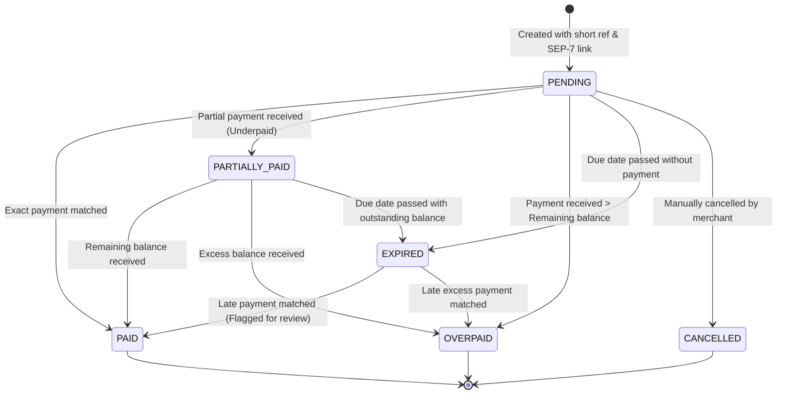
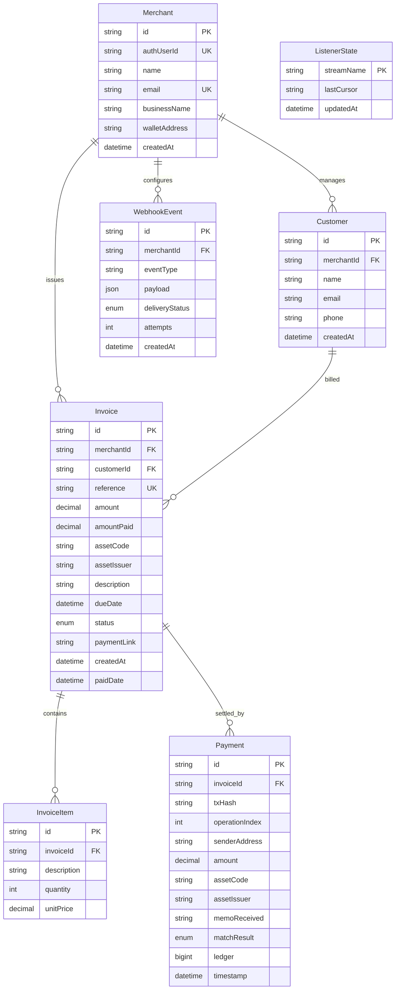

# StellarInvoice Technical Architecture Document 🏛️

This document details the architectural decisions, module interactions, data flows, state machines, and security boundaries implemented in StellarInvoice.

---

## 1. High-Level Principles & Tenets

1. **Non-Custodial by Design**: StellarInvoice never generates, stores, or handles private cryptographic keys. All funds flow directly from payer to payee on-chain.
2. **Deterministic, Zero-Drift Accounting**: Money arithmetic is never calculated using IEEE 754 floating-point numbers. All operations use `Decimal` with Stellar's 7-decimal place precision.
3. **Strict Idempotency**: Every on-chain payment operation is uniquely indexed by `(tx_hash, operation_index)`. Replaying transactions cannot double-credit invoices.
4. **Resilient Dual Ingestion**: Real-time Server-Sent Events (SSE) streaming is coupled with periodic scheduled polling sweeps (reconciler), eliminating single points of failure in event delivery.
5. **Pluggable Chain & Auth Interfaces**: Ingestion supports Horizon and Stellar RPC; authentication supports local zero-config API keys and managed Supabase Auth JWTs.

---

## 2. Module Responsibilities & System Topology

The backend is organized into two runtime entry points built from a unified modular structure:
- **`src/server.ts`**: Express REST API handling merchant requests, invoice issuance, dashboard stats, and public payment queries.
- **`src/worker.ts`**: Background daemon running the continuous payment stream listener, periodic reconciler sweeps, and maintenance jobs.

```
src/
├── config/             → Env validation (Zod), Stellar network clients, Prisma singleton
├── modules/
│   ├── auth/           → Pluggable identity verification (API Key or Supabase JWT)
│   ├── merchants/      → Merchant business profile and Stellar wallet address registration
│   ├── customers/      → Customer directory and contact records
│   ├── invoices/       → Invoice generation, 28-byte reference creation, SEP-7 links
│   ├── payments/       → Payment audit records, review queues, manual assignment
│   ├── dashboard/      → Revenue totals, overdue metrics, asset volume aggregations
│   └── webhooks/       → Signed HTTP event dispatch with SSRF protections
├── stellar/
│   ├── chainReader/    → Ingestion abstraction (Horizon SSE vs Stellar RPC polling)
│   ├── listener/       → Persistent real-time payment streaming
│   ├── matcher/        → Pure deterministic matching engine
│   ├── paymentUri/     → SEP-7 `web+stellar:pay` link builder
│   └── reconciler/     → Safety net historical ledger reconciliation sweeps
├── jobs/               → Invoice expiration, due date reminders, webhook retries
├── middleware/         → Auth guard, Zod request validation, rate limiters, error handling
├── types/              → Core TypeScript domain types, DTOs, and payment enums
├── schemas/            → Shared runtime Zod schemas (address format, invoice payloads)
└── utils/              → Short reference generator, Decimal math helpers, pino logger
```

---

## 3. Ingestion Pipeline: Listener, Matcher & Reconciler

Payment ingestion relies on three coordinated components:

```mermaid
flowchart TD
    subgraph Ingestion["Chain Ingestion Layer"]
        Reader["IChainReader<br/>(Horizon / Stellar RPC)"]
        Listener["Streaming Listener<br/>(Live SSE Stream)"]
        Reconciler["Reconciler Service<br/>(Periodic Historical Sweep)"]
    end

    subgraph Evaluation["Evaluation & Matching"]
        Matcher["Pure Payment Matcher<br/>(Deterministic Logic)"]
    end

    subgraph Storage["Storage & Persistence"]
        DB[("PostgreSQL")]
        StateTable[("ListenerState<br/>(Paging Token / Cursor)")]
    end

    Reader -->|Live Events| Listener
    Reader -->|Batch Ledgers| Reconciler
    
    Listener -->|Fetch Saved Cursor| StateTable
    Listener -->|Check (txHash, opIndex)| DB
    Reconciler -->|Check (txHash, opIndex)| DB

    Listener -->|Unprocessed Operation| Matcher
    Reconciler -->|Missed Operation| Matcher

    Matcher -->|Evaluation Result| DB
    Listener -->|Update Cursor| StateTable
```

### 1. `IChainReader` (Chain Reader Interface)
Decouples raw network calls from business logic.
- **`HorizonReader`**: Connects to Stellar Horizon `/accounts/{id}/payments?cursor={cursor}`. Streams operations in real time.
- **`RpcReader`**: Uses JSON-RPC `getEvents` and `getTransactions` with `EMIT_CLASSIC_EVENTS=true` to poll ledger updates statelessly.

### 2. `ListenerService` (Streaming Listener)
- Boots on worker startup, reads `lastCursor` from the `ListenerState` table.
- Subscribes to the stream. Upon receiving a payment operation:
  1. Checks if `(tx_hash, operation_index)` already exists in `Payment` table (early return if true).
  2. Extracts the transaction memo and normalizes payment data.
  3. Queries the candidate `Invoice` matching the memo.
  4. Invokes `MatcherService.evaluate(invoice, payment)`.
  5. In a **single database transaction**:
     - Inserts the `Payment` record.
     - Updates the `Invoice` status and `amountPaid`.
     - Updates `ListenerState.lastCursor` with the operation's paging token.

### 3. `ReconcilerService` (Fallback Sweeper)
- Runs on a cron/interval (e.g. every 3 minutes).
- Queries recent operations for the platform receiving account.
- Filters out already-persisted transactions.
- Reconciles any dropped events caused by SSE disconnects, process restarts, or temporary network partitions.

---

## 4. Invoice Status State Machine

Invoices follow a strict, unidirectional state machine. Transitions outside the defined graph are rejected.



### Valid Transition Matrix

| From State | To State | Trigger Condition |
| :--- | :--- | :--- |
| **`PENDING`** | `PAID` | `amountPaid + incomingAmount == invoice.amount` |
| **`PENDING`** | `PARTIALLY_PAID` | `amountPaid + incomingAmount < invoice.amount` |
| **`PENDING`** | `OVERPAID` | `amountPaid + incomingAmount > invoice.amount` |
| **`PENDING`** | `EXPIRED` | `now() > dueDate` evaluated by expiry job |
| **`PENDING`** | `CANCELLED` | Merchant initiates cancellation |
| **`PARTIALLY_PAID`** | `PAID` | Subsequent payment satisfies full remaining balance |
| **`PARTIALLY_PAID`** | `OVERPAID` | Subsequent payment exceeds full remaining balance |
| **`PARTIALLY_PAID`** | `EXPIRED` | `now() > dueDate` evaluated by expiry job |
| **`EXPIRED`** | `PAID` | Valid late payment arrives (matched and flagged for merchant audit) |

---

## 5. Idempotency & Cursor Strategy

### The Double-Spend / Double-Count Risk
On the Stellar blockchain, a single transaction can contain multiple operations (e.g., multiple payments or a path payment plus account merge). Furthermore, streaming connections can disconnect and replay operations from the last cursor.

### Our Two-Layer Defense:
1. **Database-Level Composite Unique Constraint**:
   ```prisma
   model Payment {
     txHash         String  @map("tx_hash")
     operationIndex Int     @map("operation_index")
     ...
     @@unique([txHash, operationIndex])
   }
   ```
   If an operation is replayed by the stream or concurrently picked up by the reconciler, the database rejects duplicate insertion with a unique constraint violation (`P2002` in Prisma), preventing double-credit.

2. **Atomic Ingestion Transaction**:
   The payment insert, invoice balance update, and cursor advancement occur within an atomic database transaction (`prisma.$transaction`). Either all state updates succeed, or the cursor is not advanced, ensuring crash consistency.

---

## 6. Database Entity Relationships (ERD)



---

## 7. Security Architecture

1. **Non-Custodial Boundary**: Keys are never held. Merchant configuration strictly records public `G...` keys.
2. **Asset Spoofing Prevention**:
   Stellar allows any account to issue assets with arbitrary codes (e.g., any account can issue a token named "USDC"). StellarInvoice enforces strict equality on **both** `asset_code` AND `asset_issuer`. Payments with matching asset codes from unrecognized issuers are flagged `WRONG_ASSET`.
3. **SSRF Webhook Protection**:
   Outgoing webhook dispatchers validate target merchant URLs:
   - Only `https://` protocols permitted in production.
   - Private, loopback, and internal IP ranges (e.g. `127.0.0.1`, `10.0.0.0/8`, `192.168.0.0/16`, AWS metadata `169.254.169.254`) are strictly blocked.
   - Payloads are signed with `X-StellarInvoice-Signature: sha256=HMAC(payload, secret)`.
4. **Tenant Isolation**:
   Every database query scoped to merchant endpoints filters on `where: { merchantId: req.user.merchantId }`. Unit and integration tests verify cross-tenant data leakage is impossible.
