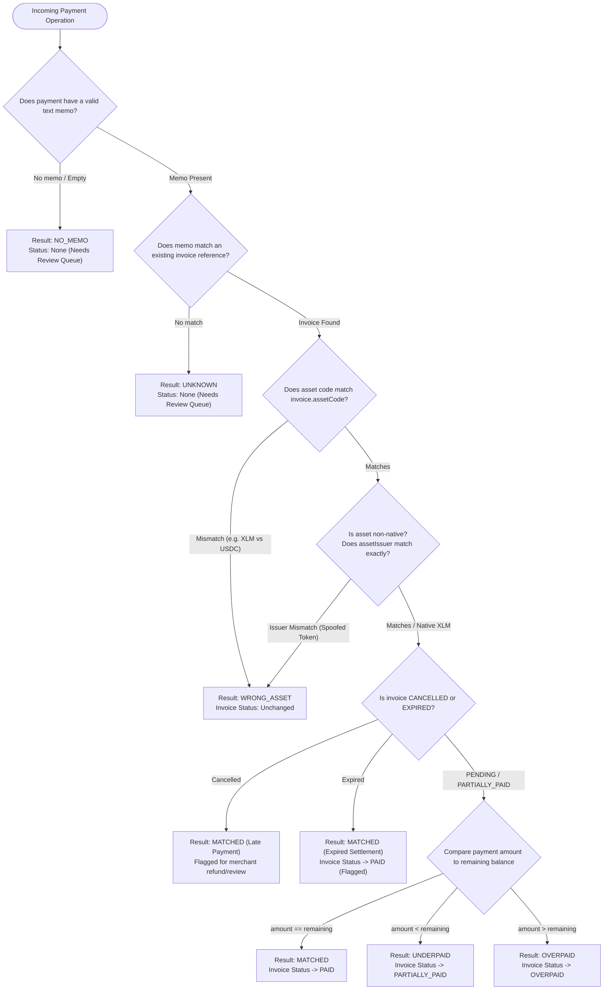

# Payment Matching Engine Specification Guide 🧭

This guide defines the deterministic rules, evaluation order, edge cases, and state transitions executed by the **StellarInvoice Pure Payment Matcher** (`apps/api/src/stellar/matcher/matcher.service.ts`).

---

## 1. Principles of the Matching Engine

The payment matcher is implemented as a **pure function**:
```typescript
function evaluatePayment(
  invoice: MatcherInvoiceCandidate | null,
  payment: MatcherPaymentInput
): MatcherEvaluationResult
```
* **Zero Side Effects**: The function performs no network I/O, does not query the database directly, and does not alter input objects.
* **Deterministic Output**: Given the exact same invoice candidate and incoming payment details, it always returns the identical `MatcherEvaluationResult`.
* **Zero Floating-Point Drift**: All balance comparisons use `Decimal.js` with 7-decimal place precision.

---

## 2. Evaluation Decision Tree

When a normalized payment operation arrives from the chain reader, the engine executes the following evaluation pipeline:



---

## 3. Detailed Match Result Definitions

### 1. `MATCHED`
* **Condition**:
  * Memo matches invoice `reference` exactly.
  * Asset code matches `invoice.assetCode`.
  * Asset issuer matches `invoice.assetIssuer` (or both are null for native XLM).
  * Payment `amount` exactly equals `invoice.amount - invoice.amountPaid`.
* **Invoice State Transition**:
  * If status was `PENDING` or `PARTIALLY_PAID` $\rightarrow$ transitions to `PAID`.
  * `paidDate` timestamp set to the Stellar ledger close time.
  * `amountPaid` becomes equal to `invoice.amount`.
* **Downstream Action**: Triggers `invoice.paid` webhook notification.

---

### 2. `UNDERPAID`
* **Condition**:
  * Memo and asset match perfectly.
  * Payment `amount` is less than `invoice.amount - invoice.amountPaid`.
* **Invoice State Transition**:
  * Status transitions to (or remains) `PARTIALLY_PAID`.
  * `amountPaid` is incremented by the payment amount.
* **Downstream Action**:
  * Payment record is persisted and linked to the invoice.
  * An `invoice.partially_paid` event is dispatched.
  * Customer can pay the remaining balance using the same reference memo.

---

### 3. `OVERPAID`
* **Condition**:
  * Memo and asset match perfectly.
  * Payment `amount` strictly exceeds `invoice.amount - invoice.amountPaid`.
* **Invoice State Transition**:
  * Status transitions to `OVERPAID`.
  * `amountPaid` is updated to reflect the total accumulated payment.
* **Downstream Action**:
  * Marked as resolved for billing, but flagged in the merchant dashboard with the surplus amount so the merchant can optionally issue an on-chain refund to the sender address.

---

### 4. `WRONG_ASSET`
* **Condition**:
  * Memo matches an invoice, but the sent asset differs in code (e.g. customer sent XLM when invoice requested USDC), OR
  * The asset code is "USDC" but the `assetIssuer` does **not** match the invoice's verified issuer address (counterfeit token).
* **Invoice State Transition**:
  * The invoice remains in its current status (`PENDING` or `PARTIALLY_PAID`).
  * `amountPaid` is **NOT** credited.
* **Downstream Action**:
  * The payment is saved with `matchResult = WRONG_ASSET` and linked to the invoice for auditability.
  * Placed in the merchant's **"Needs Review"** queue.

---

### 5. `NO_MEMO`
* **Condition**:
  * Payment received on the merchant or platform wallet with no transaction memo or an empty string.
* **Invoice State Transition**:
  * No invoice is affected.
* **Downstream Action**:
  * Payment is recorded with `invoiceId = null` and `matchResult = NO_MEMO`.
  * Routed to the **"Needs Review"** administrative queue.
  * Merchant can manually inspect and assign this payment to an open invoice via `POST /api/v1/payments/:id/assign`.

---

### 6. `UNKNOWN`
* **Condition**:
  * Payment includes a memo, but the memo string does not match any invoice reference in the database.
* **Invoice State Transition**:
  * No invoice is affected.
* **Downstream Action**:
  * Saved with `matchResult = UNKNOWN`.
  * Routed to the merchant's review queue.

---

## 4. Special Edge Cases

### A. Late Payment on Expired Invoice
* **Scenario**: Customer pays an invoice after `dueDate` has passed and the background job already marked the invoice `EXPIRED`.
* **Handling**:
  * The payment is valid on-chain and cannot be reversed automatically.
  * The matcher returns `MATCHED` with audit notes: `"Late payment received on expired invoice"`.
  * Status moves to `PAID`, with a flag in the dashboard alerting the merchant that delivery/fulfillment may need manual re-confirmation.

### B. Path Payments (Strict Send / Strict Receive)
* **Scenario**: Customer uses path payment to swap an alternate asset into the invoice's requested asset during submission.
* **Handling**:
  * The chain reader inspects the **destination operation**: the recipient account, the destination asset, and the destination received amount.
  * As long as the destination asset and destination amount meet the invoice terms, the matcher treats it identically to a direct payment.

### C. Multi-Operation Transactions
* **Scenario**: A single Stellar transaction contains 3 separate payment operations to the merchant wallet.
* **Handling**:
  * Stellar memos are set at the **transaction** level.
  * Each operation has a distinct `operation_index` (0, 1, 2).
  * Each operation is processed individually against the unique constraint `(tx_hash, operation_index)`.

